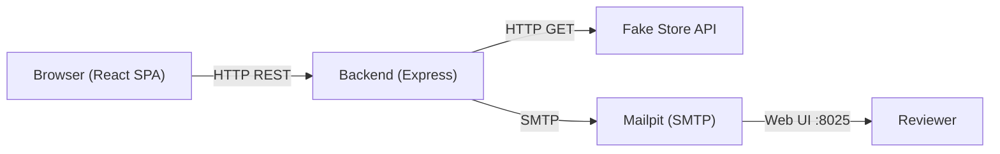
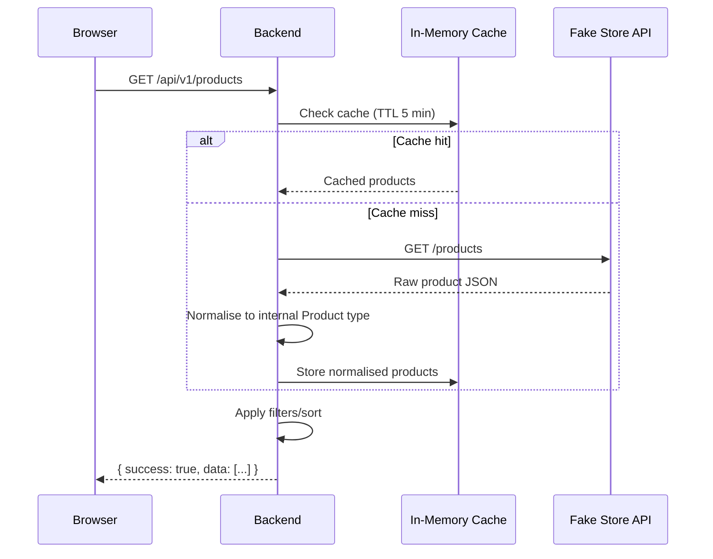
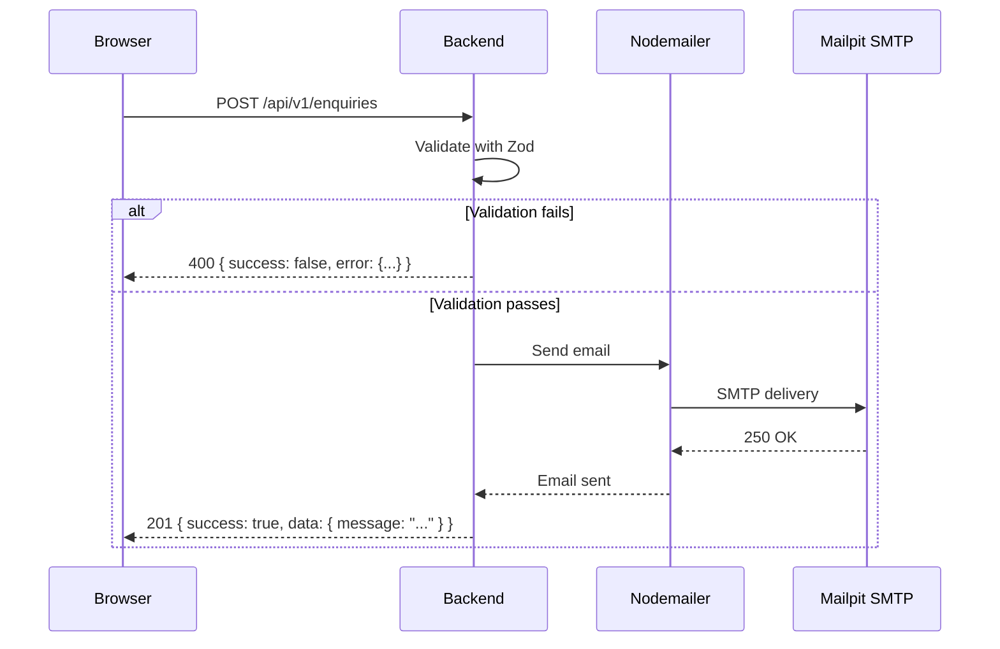

# Plan.md — Product Catalogue Implementation Specification

> **Status:** Implementation-ready  
> **Version:** 1.0  
> **Last updated:** 2026-11-21

---

## Table of Contents

- [A. Project Overview](#a-project-overview)
- [B. Architecture and Technical Decisions](#b-architecture-and-technical-decisions)
- [C. Complete Project Structure](#c-complete-project-structure)
- [D. Backend Implementation Specification](#d-backend-implementation-specification)
- [E. Frontend Implementation Specification](#e-frontend-implementation-specification)
- [F. External Integrations](#f-external-integrations)
- [G. Data Contracts and Types](#g-data-contracts-and-types)
- [H. Testing Strategy](#h-testing-strategy)
- [I. Development and Execution Plan](#i-development-and-execution-plan)
- [J. Local Setup and Developer Experience](#j-local-setup-and-developer-experience)
- [K. Quality and Submission Checklist](#k-quality-and-submission-checklist)

---

## A. Project Overview

### A.1 Problem Statement

An entrepreneur wants a product catalogue proof of concept that customers can interact with to browse products, search, view details, and submit enquiries. The PoC must not be throwaway — it must be a foundation that can grow. The product data source, look and feel, and email provider are all expected to change in the future.

### A.2 Goals and Scope

| Goal | Description |
|------|-------------|
| **Functional catalogue** | Home page, category pages, search, product details, and enquiry submission |
| **Backend proxy** | All Fake Store API access goes through our backend — the frontend never calls it directly |
| **Email notifications** | Sales inbox receives an email when an enquiry is submitted |
| **Evolvable design** | Adapters/providers abstract external integrations so data sources and email providers can be swapped |
| **Local development** | A reviewer runs the entire stack locally in under 10 minutes with no paid accounts |

### A.3 Functional Requirements

| ID | Requirement |
|----|-------------|
| **FR-01** | The home page displays exactly 5 top-rated products (the 5 products with the highest `rating.rate` across the entire catalogue; ties broken by higher `rating.count`, then lower `id`) |
| **FR-02** | A category page displays top-rated products for that category (the top 3 by the same sort) followed by the remaining products in that category sorted by `rating.rate` descending |
| **FR-03** | Search accepts a text query and returns only products whose `title` or `description` contains the query (case-insensitive substring match) |
| **FR-04** | Clicking a product card navigates to a product detail page showing all product information |
| **FR-05** | The product detail page includes an "Enquire" button that opens an enquiry form |
| **FR-06** | The enquiry form collects: first name, last name, email, phone (optional), and message |
| **FR-07** | On submission, the backend sends an email to the sales inbox and returns a success response |
| **FR-08** | The customer sees a "Thank you" confirmation after a successful submission |
| **FR-09** | Navigation includes links to all product categories and a persistent search bar |

### A.4 Non-Functional Requirements

| ID | Requirement |
|----|-------------|
| **NFR-01** | The frontend is a React SPA built with TypeScript in strict mode |
| **NFR-02** | The backend is a Node.js application built with TypeScript in strict mode |
| **NFR-03** | Validation uses Zod on both frontend and backend |
| **NFR-04** | Tests use Vitest (unit/integration), Supertest (API), and Playwright (E2E) |
| **NFR-05** | Email delivery uses Nodemailer with Mailpit for local development |
| **NFR-06** | Local infrastructure uses Docker Compose for Mailpit only |
| **NFR-07** | The application is responsive (mobile-first: 320px, tablet: 768px, desktop: 1024px breakpoints) |
| **NFR-08** | Basic accessibility: semantic HTML, ARIA labels on interactive elements, keyboard navigation, sufficient colour contrast |
| **NFR-09** | All API responses follow a consistent envelope structure |
| **NFR-10** | Error states are handled gracefully in both frontend and backend |

### A.5 Explicit Assumptions and Constraints

| # | Assumption |
|---|-----------|
| 1 | The Fake Store API has exactly 20 products across 4 categories: `electronics`, `jewelery`, `men's clothing`, `women's clothing`. The dataset is small enough to fetch all products in a single API call and perform filtering/sorting in-memory on our backend. |
| 2 | "Top rated" means sorted by `rating.rate` descending. Ties are broken by `rating.count` descending, then by `id` ascending. |
| 3 | "I have chosen 5 products to be top rated" means the system algorithmically selects the 5 highest-rated products — there is no admin UI for manual selection. |
| 4 | Search is performed server-side. The backend fetches all products from Fake Store API, filters by case-insensitive substring match against `title` and `description`, and returns matching results. |
| 5 | The enquiry form is associated with a specific product. The email includes the product name and ID so the sales team knows which product the customer is enquiring about. |
| 6 | "Sales inbox" is a configured email address (`SALES_EMAIL` env var), defaulting to `sales@example.com` for local dev. |
| 7 | The Fake Store API is treated as eventually available — temporary failures return a user-friendly error, not a crash. |
| 8 | No authentication, authorisation, database, payment, cart, or user accounts are required. |
| 9 | The Fake Store API data may be cached in-memory on the backend with a 5-minute TTL to reduce upstream calls and improve response times. |
| 10 | The phone field on the enquiry form is optional. All other fields are required. |
| 11 | The backend runs on port 3001 and the frontend dev server runs on port 5173 (Vite default). |
| 12 | The monorepo uses a simple folder structure (`client/` and `server/`) without workspaces tooling — this keeps setup simple for the reviewer. |

### A.6 Out of Scope

- User authentication and authorisation
- Shopping cart or checkout
- Payment processing
- Database persistence
- Admin interface for managing products
- Product image upload
- Deployment to cloud providers
- CI/CD pipeline configuration
- Rate limiting and API key management
- Internationalisation (i18n)
- Dark mode
- SSR / Server-Side Rendering (the frontend is a client-side SPA)
- WebSocket or real-time updates

---

## B. Architecture and Technical Decisions

### B.1 Overall Architecture

The system follows a **three-tier architecture**: React SPA → Express API → Fake Store API, with Nodemailer/Mailpit for email.



**Component responsibilities:**

| Component | Responsibility |
|-----------|---------------|
| **React SPA** (`client/`) | UI rendering, routing, form validation (client-side), API calls to our backend |
| **Express API** (`server/`) | Proxies Fake Store API, normalises data, handles enquiry submissions, sends email, validates input |
| **Fake Store API** | Upstream source of product data (read-only) |
| **Mailpit** | Local SMTP server and web UI for viewing sent emails during development |

### B.2 Frontend-Backend Communication Flow

1. The React SPA makes HTTP requests to `http://localhost:3001/api/v1/*`.
2. The Express backend processes each request, calls the Fake Store API if needed, transforms the data, and returns a JSON response in a consistent envelope.
3. CORS is configured on the backend to allow requests from `http://localhost:5173`.

### B.3 Product Data Flow



**Key decisions:**
- All 20 products are fetched in a single call to `GET https://fakestoreapi.com/products` and cached in-memory.
- Filtering (by category, search query) and sorting (by rating) happen in the backend after cache retrieval.
- Individual product detail requests (`GET /api/v1/products/:id`) also use the cache — they look up by ID in the cached array.

### B.4 Enquiry Submission and Email Delivery Flow



### B.5 Adapter/Provider Design

External integrations are abstracted behind interfaces so they can be swapped without changing business logic.

**Product data provider:**
```
interface ProductProvider {
  getAllProducts(): Promise<Product[]>
  getProductById(id: number): Promise<Product | null>
  getCategories(): Promise<string[]>
}
```
- `FakeStoreProductProvider` implements this interface.
- A future provider (e.g., a real database) implements the same interface.

**Email provider:**
```
interface EmailProvider {
  sendEmail(options: SendEmailOptions): Promise<void>
}
```
- `NodemailerEmailProvider` implements this interface.
- A future provider (e.g., SendGrid, SES) implements the same interface.

### B.6 Error Handling Strategy

**Backend:**

| Scenario | HTTP Status | Response |
|----------|-------------|----------|
| Successful request | 200 or 201 | `{ success: true, data: ... }` |
| Validation error | 400 | `{ success: false, error: { message: "Validation failed", details: [...] } }` |
| Product not found | 404 | `{ success: false, error: { message: "Product not found" } }` |
| Fake Store API unavailable | 502 | `{ success: false, error: { message: "Unable to fetch product data. Please try again later." } }` |
| Email delivery failure | 502 | `{ success: false, error: { message: "Unable to send enquiry. Please try again later." } }` |
| Unhandled server error | 500 | `{ success: false, error: { message: "Internal server error" } }` |

- A global error-handling middleware catches unhandled errors, logs them, and returns the 500 response.
- The backend never exposes internal error details (stack traces, upstream URLs) to the client.

**Frontend:**

| Scenario | UI Behaviour |
|----------|-------------|
| API returns error | Display an inline error banner with the error message, offer a "Try again" button |
| Network failure | Display "Unable to connect to the server. Please check your connection and try again." |
| Loading state | Display a spinner/skeleton for each data section |
| Empty search results | Display "No products found matching your search." |
| Empty category | Display "No products found in this category." |

### B.7 Configuration and Environment Variables

All configuration is via environment variables. No secrets are committed.

**Backend (`server/.env`):**

| Variable | Default | Description |
|----------|---------|-------------|
| `PORT` | `3001` | Backend server port |
| `FAKE_STORE_API_URL` | `https://fakestoreapi.com` | Upstream product API base URL |
| `PRODUCT_CACHE_TTL_MS` | `300000` | Cache TTL in milliseconds (5 minutes) |
| `SMTP_HOST` | `localhost` | SMTP server host |
| `SMTP_PORT` | `1025` | SMTP server port |
| `SMTP_SECURE` | `false` | Use TLS for SMTP |
| `EMAIL_FROM` | `noreply@catalogue.local` | Sender email address |
| `SALES_EMAIL` | `sales@example.com` | Recipient email for enquiries |
| `CORS_ORIGIN` | `http://localhost:5173` | Allowed CORS origin |
| `NODE_ENV` | `development` | Environment identifier |

**Frontend (`client/.env`):**

| Variable | Default | Description |
|----------|---------|-------------|
| `VITE_API_BASE_URL` | `http://localhost:3001/api/v1` | Backend API base URL |

### B.8 Key Technical Decisions and Trade-offs

#### ADR-001: Monorepo with simple folder structure

- **Decision:** Use `client/` and `server/` folders in a single repository without npm/yarn workspaces.
- **Rationale:** Simplest setup for a reviewer. Shared types are copied (not symlinked) to avoid tooling complexity. The 20-type surface area makes duplication manageable.
- **Trade-off:** Types must be manually kept in sync. Acceptable for this PoC size; a future iteration could introduce a `shared/` package with workspaces.

#### ADR-002: In-memory caching instead of Redis

- **Decision:** Cache all product data in a simple `Map` with TTL-based expiration.
- **Rationale:** Only 20 products. No need for external cache infrastructure. Keeps `docker-compose.yml` to Mailpit only.
- **Trade-off:** Cache is per-process and lost on restart. Acceptable for a PoC.

#### ADR-003: Fetch all products and filter/sort in backend

- **Decision:** Fetch all 20 products from Fake Store API in one call, then filter and sort in-memory.
- **Rationale:** The Fake Store API does not support filtering by rating or text search. The dataset is 20 items — small enough for in-memory operations. Making 20 individual API calls would be slower.
- **Trade-off:** Would not scale to thousands of products. Acceptable because the data source will be replaced.

#### ADR-004: Vite for frontend tooling

- **Decision:** Use Vite with React and TypeScript template.
- **Rationale:** Fast dev server, hot module replacement, optimised production builds. Industry standard for new React projects.
- **Trade-off:** None significant for this use case.

#### ADR-005: Express for backend framework

- **Decision:** Use Express.js (v4) with TypeScript.
- **Rationale:** Lightweight, well-documented, widely understood. Adequate for a small API with 6 endpoints.
- **Trade-off:** Less opinionated than NestJS or Fastify. For this PoC size, convention over configuration is not needed.

#### ADR-006: React Router for client-side routing

- **Decision:** Use React Router v7 for SPA routing.
- **Rationale:** De facto standard for React SPAs. Supports nested routes, URL parameters, and programmatic navigation.
- **Trade-off:** None significant.

#### ADR-007: TanStack Query for server state management

- **Decision:** Use TanStack Query (React Query) for data fetching, caching, and synchronisation.
- **Rationale:** Handles loading/error states, caching, refetching, and deduplication out of the box. Avoids manual `useEffect` + `useState` data fetching patterns.
- **Trade-off:** Additional dependency. Justified by the significant reduction in boilerplate for 6 API-consuming pages/components.

#### ADR-008: CSS Modules for styling

- **Decision:** Use CSS Modules (`.module.css` files) for component styling.
- **Rationale:** Scoped styles without additional dependencies. No runtime cost. Works out of the box with Vite.
- **Trade-off:** Less powerful than Tailwind or styled-components for complex design systems. Adequate for a PoC.

---

## C. Complete Project Structure

```
OpenWorks Assignment/
├── Plan.md                          # This document
├── DECISIONS.md                     # Assumptions and trade-offs
├── AI_USAGE.md                      # AI tools, prompts, and observations
├── README.md                        # Setup instructions and project overview
├── docker-compose.yml               # Mailpit service
├── .gitignore                       # Root-level gitignore
│
├── client/                          # React frontend
│   ├── package.json
│   ├── tsconfig.json
│   ├── tsconfig.node.json
│   ├── vite.config.ts
│   ├── index.html
│   ├── .env.example
│   ├── playwright.config.ts
│   │
│   ├── public/
│   │   └── favicon.svg
│   │
│   ├── src/
│   │   ├── main.tsx                 # App entry point, renders <App />
│   │   ├── App.tsx                  # Router setup, layout wrapper
│   │   ├── vite-env.d.ts            # Vite type declarations
│   │   │
│   │   ├── types/
│   │   │   └── index.ts             # All frontend TypeScript types
│   │   │
│   │   ├── api/
│   │   │   └── client.ts            # API client (fetch wrapper + all endpoint functions)
│   │   │
│   │   ├── validation/
│   │   │   └── enquiry.ts           # Zod schema for enquiry form (client-side)
│   │   │
│   │   ├── hooks/
│   │   │   ├── useProducts.ts       # TanStack Query hook: fetch products (home, category, search)
│   │   │   ├── useProduct.ts        # TanStack Query hook: fetch single product
│   │   │   ├── useCategories.ts     # TanStack Query hook: fetch categories
│   │   │   └── useEnquiry.ts        # TanStack Query mutation hook: submit enquiry
│   │   │
│   │   ├── components/
│   │   │   ├── Layout/
│   │   │   │   ├── Layout.tsx           # Page shell: Header + main + Footer
│   │   │   │   ├── Layout.module.css
│   │   │   │   ├── Header.tsx           # Logo, category nav links, search bar
│   │   │   │   ├── Header.module.css
│   │   │   │   ├── Footer.tsx           # Simple footer
│   │   │   │   └── Footer.module.css
│   │   │   │
│   │   │   ├── ProductCard/
│   │   │   │   ├── ProductCard.tsx      # Card displaying product image, title, price, rating
│   │   │   │   └── ProductCard.module.css
│   │   │   │
│   │   │   ├── ProductGrid/
│   │   │   │   ├── ProductGrid.tsx      # Grid layout for an array of ProductCard components
│   │   │   │   └── ProductGrid.module.css
│   │   │   │
│   │   │   ├── SearchBar/
│   │   │   │   ├── SearchBar.tsx        # Text input + submit button, calls onSearch callback
│   │   │   │   └── SearchBar.module.css
│   │   │   │
│   │   │   ├── EnquiryForm/
│   │   │   │   ├── EnquiryForm.tsx      # Form fields, validation, submit logic
│   │   │   │   └── EnquiryForm.module.css
│   │   │   │
│   │   │   ├── StarRating/
│   │   │   │   ├── StarRating.tsx       # Visual star display for product rating
│   │   │   │   └── StarRating.module.css
│   │   │   │
│   │   │   ├── ErrorBanner/
│   │   │   │   ├── ErrorBanner.tsx      # Reusable error display with optional retry button
│   │   │   │   └── ErrorBanner.module.css
│   │   │   │
│   │   │   ├── LoadingSpinner/
│   │   │   │   ├── LoadingSpinner.tsx   # Spinner shown during data fetching
│   │   │   │   └── LoadingSpinner.module.css
│   │   │   │
│   │   │   └── EmptyState/
│   │   │       ├── EmptyState.tsx       # "No results" display with configurable message
│   │   │       └── EmptyState.module.css
│   │   │
│   │   ├── pages/
│   │   │   ├── HomePage/
│   │   │   │   ├── HomePage.tsx         # Fetches and displays 5 top-rated products
│   │   │   │   └── HomePage.module.css
│   │   │   │
│   │   │   ├── CategoryPage/
│   │   │   │   ├── CategoryPage.tsx     # Fetches and displays products for a category
│   │   │   │   └── CategoryPage.module.css
│   │   │   │
│   │   │   ├── SearchResultsPage/
│   │   │   │   ├── SearchResultsPage.tsx # Fetches and displays search results
│   │   │   │   └── SearchResultsPage.module.css
│   │   │   │
│   │   │   ├── ProductDetailPage/
│   │   │   │   ├── ProductDetailPage.tsx # Displays product details + Enquire button
│   │   │   │   └── ProductDetailPage.module.css
│   │   │   │
│   │   │   ├── EnquiryPage/
│   │   │   │   ├── EnquiryPage.tsx      # Hosts EnquiryForm for a specific product
│   │   │   │   └── EnquiryPage.module.css
│   │   │   │
│   │   │   ├── ThankYouPage/
│   │   │   │   ├── ThankYouPage.tsx     # Confirmation message after enquiry
│   │   │   │   └── ThankYouPage.module.css
│   │   │   │
│   │   │   └── NotFoundPage/
│   │   │       ├── NotFoundPage.tsx     # 404 page for unmatched routes
│   │   │       └── NotFoundPage.module.css
│   │   │
│   │   └── styles/
│   │       ├── global.css               # CSS reset, CSS variables, global typography
│   │       └── variables.css            # Design tokens: colours, spacing, breakpoints
│   │
│   └── e2e/
│       ├── home.spec.ts                 # E2E: home page displays 5 products
│       ├── category.spec.ts             # E2E: category page navigation and display
│       ├── search.spec.ts               # E2E: search flow
│       ├── product-detail.spec.ts       # E2E: product detail view
│       └── enquiry.spec.ts              # E2E: full enquiry submission flow
│
└── server/
    ├── package.json
    ├── tsconfig.json
    ├── .env.example
    │
    ├── src/
    │   ├── index.ts                     # App entry point: starts Express server
    │   ├── app.ts                       # Express app setup: middleware, routes, error handler
    │   │
    │   ├── config/
    │   │   └── index.ts                 # Loads and validates env vars with Zod, exports typed config object
    │   │
    │   ├── types/
    │   │   └── index.ts                 # All backend TypeScript types and interfaces
    │   │
    │   ├── validation/
    │   │   └── enquiry.ts               # Zod schema for enquiry request body
    │   │
    │   ├── middleware/
    │   │   ├── errorHandler.ts          # Global error-handling middleware
    │   │   └── validateBody.ts          # Generic Zod validation middleware factory
    │   │
    │   ├── routes/
    │   │   ├── productRoutes.ts         # Product and category route definitions
    │   │   └── enquiryRoutes.ts         # Enquiry route definitions
    │   │
    │   ├── controllers/
    │   │   ├── productController.ts     # Request handlers for product endpoints
    │   │   └── enquiryController.ts     # Request handler for enquiry endpoint
    │   │
    │   ├── services/
    │   │   ├── productService.ts        # Business logic: sorting, filtering, top-rated selection
    │   │   └── enquiryService.ts        # Business logic: compose email, call email provider
    │   │
    │   └── providers/
    │       ├── productProvider.ts        # ProductProvider interface + FakeStoreProductProvider
    │       ├── emailProvider.ts          # EmailProvider interface + NodemailerEmailProvider
    │       └── cache.ts                 # Simple TTL cache: get/set/clear with configurable expiry
    │
    └── tests/
        ├── unit/
        │   ├── productService.test.ts   # Unit tests for product business logic
        │   ├── enquiryService.test.ts   # Unit tests for enquiry business logic
        │   └── cache.test.ts            # Unit tests for cache module
        │
        └── integration/
            ├── productRoutes.test.ts    # API integration tests for product endpoints
            └── enquiryRoutes.test.ts    # API integration tests for enquiry endpoint
```

### C.1 Module Responsibility Map

#### Backend Modules

| Module | Responsibility | Exports | Dependencies |
|--------|---------------|---------|-------------|
| `src/index.ts` | Entry point. Creates app, starts HTTP server on configured port. | Nothing (side-effect module) | `app.ts`, `config/` |
| `src/app.ts` | Configures Express: JSON body parser, CORS, routes, global error handler. | `createApp(): Express` | `routes/*`, `middleware/*`, `config/` |
| `src/config/index.ts` | Parses `process.env` through a Zod schema, exports a typed `config` object. Throws on startup if required vars are missing. | `config: AppConfig` | `zod` |
| `src/types/index.ts` | All TypeScript interfaces: `Product`, `ProductRating`, `FakeStoreProduct`, `EnquiryRequest`, `ApiResponse`, `ApiErrorResponse`, `SendEmailOptions`, `ProductProvider`, `EmailProvider`. | All types | None |
| `src/validation/enquiry.ts` | Zod schema for enquiry request body. Reused by `validateBody` middleware. | `enquirySchema: ZodSchema` | `zod` |
| `src/middleware/errorHandler.ts` | Express error middleware. Logs the error, returns `{ success: false, error: { message } }` with appropriate status code. | `errorHandler: ErrorRequestHandler` | `types/` |
| `src/middleware/validateBody.ts` | Factory function that takes a Zod schema and returns Express middleware. Parses `req.body`; on failure, returns 400 with field-level error details. | `validateBody(schema): RequestHandler` | `zod` |
| `src/routes/productRoutes.ts` | Defines routes: `GET /products`, `GET /products/:id`, `GET /categories`, `GET /categories/:name/products`, `GET /products/search`. Binds to controller functions. | `productRouter: Router` | `controllers/productController` |
| `src/routes/enquiryRoutes.ts` | Defines route: `POST /enquiries`. Applies `validateBody(enquirySchema)` middleware. Binds to controller function. | `enquiryRouter: Router` | `controllers/enquiryController`, `middleware/validateBody`, `validation/enquiry` |
| `src/controllers/productController.ts` | Handles HTTP request/response for product endpoints. Calls `productService` methods, wraps results in API envelope. | `getTopRatedProducts`, `getProductById`, `getCategories`, `getProductsByCategory`, `searchProducts` | `services/productService` |
| `src/controllers/enquiryController.ts` | Handles HTTP request/response for enquiry endpoint. Calls `enquiryService`, returns success or error envelope. | `submitEnquiry` | `services/enquiryService` |
| `src/services/productService.ts` | Business logic for products. Calls `ProductProvider` to get raw data, applies in-memory sorting, filtering, top-N selection. Owns the caching logic via `cache.ts`. | `ProductService` class with methods: `getTopRated(n)`, `getById(id)`, `getCategories()`, `getByCategory(name)`, `search(query)` | `providers/productProvider`, `providers/cache` |
| `src/services/enquiryService.ts` | Composes the email subject and HTML body from the enquiry data and product info, calls `EmailProvider.sendEmail()`. | `EnquiryService` class with method: `submitEnquiry(data)` | `providers/emailProvider`, `services/productService` |
| `src/providers/productProvider.ts` | Defines `ProductProvider` interface. `FakeStoreProductProvider` implements it: fetches from Fake Store API via `fetch()`, maps `FakeStoreProduct` → `Product`. | `ProductProvider` interface, `FakeStoreProductProvider` class | `types/`, `config/` |
| `src/providers/emailProvider.ts` | Defines `EmailProvider` interface. `NodemailerEmailProvider` implements it: creates Nodemailer transport, sends email. | `EmailProvider` interface, `NodemailerEmailProvider` class | `nodemailer`, `config/` |
| `src/providers/cache.ts` | Generic TTL cache. `get<T>(key)` returns cached value or `null`. `set<T>(key, value, ttlMs)` stores with expiry timestamp. `clear()` removes all entries. | `Cache` class | None |

#### Frontend Modules

| Module | Responsibility | Exports | Dependencies |
|--------|---------------|---------|-------------|
| `src/main.tsx` | Mounts `<App />` into `#root`, wraps in `QueryClientProvider` and `BrowserRouter`. | Nothing (side-effect) | `App.tsx`, `@tanstack/react-query`, `react-router-dom` |
| `src/App.tsx` | Defines routes inside `<Layout />`. Route table maps paths to page components. | `App` component | All page components, `Layout`, `react-router-dom` |
| `src/types/index.ts` | All frontend TypeScript types: `Product`, `ProductRating`, `Category`, `EnquiryFormData`, `EnquiryResponse`, `ApiResponse<T>`, `ApiErrorResponse`. | All types | None |
| `src/api/client.ts` | `apiFetch(path, options)` wrapper around `fetch` that prepends `VITE_API_BASE_URL`, sets `Content-Type`, handles non-OK responses. Exports specific endpoint functions: `fetchTopRatedProducts()`, `fetchProduct(id)`, `fetchCategories()`, `fetchProductsByCategory(name)`, `searchProducts(query)`, `submitEnquiry(data)`. | All API functions | `types/` |
| `src/validation/enquiry.ts` | Zod schema mirroring the backend schema. Used by `EnquiryForm` for client-side validation before submission. | `enquiryFormSchema`, `EnquiryFormData` type | `zod` |
| `src/hooks/useProducts.ts` | `useTopRatedProducts()` — calls `fetchTopRatedProducts`. `useProductsByCategory(category)` — calls `fetchProductsByCategory`. `useSearchResults(query)` — calls `searchProducts`, enabled only when query is non-empty. | Custom hooks | `@tanstack/react-query`, `api/client` |
| `src/hooks/useProduct.ts` | `useProduct(id)` — calls `fetchProduct`. | Custom hook | `@tanstack/react-query`, `api/client` |
| `src/hooks/useCategories.ts` | `useCategories()` — calls `fetchCategories`. Used by Header to render nav links. | Custom hook | `@tanstack/react-query`, `api/client` |
| `src/hooks/useEnquiry.ts` | `useEnquiryMutation()` — `useMutation` wrapping `submitEnquiry`. Returns `mutate`, `isPending`, `isSuccess`, `isError`, `error`. On success, navigates to Thank You page. | Custom hook | `@tanstack/react-query`, `api/client`, `react-router-dom` |
| `src/components/Layout/` | `Layout` renders `<Header />`, `<main><Outlet /></main>`, `<Footer />`. `Header` renders logo (link to `/`), category nav (from `useCategories`), `<SearchBar />`. `Footer` renders simple copyright text. | `Layout`, `Header`, `Footer` | `useCategories`, `SearchBar`, `react-router-dom` |
| `src/components/ProductCard/` | Renders a product card: image, title, price (formatted as currency), `<StarRating />`, category badge. The entire card is a link to `/products/:id`. | `ProductCard` | `StarRating`, `types/`, `react-router-dom` |
| `src/components/ProductGrid/` | Renders a responsive CSS Grid of `ProductCard` components. Accepts `products: Product[]` and an optional `title: string`. | `ProductGrid` | `ProductCard` |
| `src/components/SearchBar/` | Controlled text input with a "Search" button. On submit, navigates to `/search?q={query}` using `useNavigate`. Trims whitespace. Does not submit if empty. | `SearchBar` | `react-router-dom` |
| `src/components/EnquiryForm/` | Form with fields: firstName, lastName, email, phone, message. Validates on submit using `enquiryFormSchema`. Displays field-level errors. Calls `useEnquiryMutation`. Disables submit button while pending. | `EnquiryForm` | `useEnquiry`, `validation/enquiry` |
| `src/components/StarRating/` | Renders filled and empty stars based on a `rate` number (0–5). Displays `rate` and `count` as text. | `StarRating` | None |
| `src/components/ErrorBanner/` | Displays an error message with an optional "Try again" button. Accepts `message: string` and `onRetry?: () => void`. | `ErrorBanner` | None |
| `src/components/LoadingSpinner/` | Centred CSS spinner. | `LoadingSpinner` | None |
| `src/components/EmptyState/` | Icon + message display. Accepts `message: string`. | `EmptyState` | None |

---

## D. Backend Implementation Specification

All routes are prefixed with `/api/v1`.

### D.1 GET /api/v1/products — Top-Rated Products (Home Page)

**Purpose:** Returns the top-rated products for the home page.

**Query Parameters:**

| Parameter | Type | Default | Description |
|-----------|------|---------|-------------|
| `limit` | number | `5` | Number of top-rated products to return (1–20) |

**Validation:** `limit` must be an integer between 1 and 20 (inclusive). Invalid values return 400.

**Business Logic:**
1. Fetch all products from the product provider (uses cache).
2. Sort by `rating.rate` descending, then `rating.count` descending, then `id` ascending.
3. Return the first `limit` products.

**Success Response (200):**
```json
{
  "success": true,
  "data": [
    {
      "id": 1,
      "title": "Fjallraven - Foldsack No. 1 Backpack, Fits 15 Laptops",
      "price": 109.95,
      "description": "Your perfect pack for everyday use and target description ...",
      "category": "men's clothing",
      "image": "https://fakestoreapi.com/img/81fPKd-2AYL._AC_SL1500_.jpg",
      "rating": {
        "rate": 3.9,
        "count": 120
      }
    }
  ]
}
```

**Error Responses:**

| Status | Condition | Response |
|--------|-----------|----------|
| 400 | Invalid `limit` value | `{ "success": false, "error": { "message": "Validation failed", "details": [{ "field": "limit", "message": "Must be an integer between 1 and 20" }] } }` |
| 502 | Fake Store API unavailable | `{ "success": false, "error": { "message": "Unable to fetch product data. Please try again later." } }` |

---

### D.2 GET /api/v1/products/search — Search Products

**Purpose:** Returns products matching a text query.

**Query Parameters:**

| Parameter | Type | Required | Description |
|-----------|------|----------|-------------|
| `q` | string | Yes | Search query (1–200 characters, trimmed) |

**Validation:** `q` must be a non-empty string after trimming, max 200 characters. Missing or empty `q` returns 400.

**Business Logic:**
1. Fetch all products from the product provider (uses cache).
2. Trim the query and convert to lowercase.
3. Filter products where `title.toLowerCase()` or `description.toLowerCase()` includes the query string.
4. Sort results by `rating.rate` descending (same tie-breaking as home page).
5. Return all matching products.

**Success Response (200):**
```json
{
  "success": true,
  "data": [
    {
      "id": 1,
      "title": "Fjallraven - Foldsack No. 1 Backpack, Fits 15 Laptops",
      "price": 109.95,
      "description": "Your perfect pack ...",
      "category": "men's clothing",
      "image": "https://fakestoreapi.com/img/81fPKd-2AYL._AC_SL1500_.jpg",
      "rating": { "rate": 3.9, "count": 120 }
    }
  ]
}
```

**When no products match, the response is a successful empty array:**
```json
{
  "success": true,
  "data": []
}
```

**Error Responses:**

| Status | Condition | Response |
|--------|-----------|----------|
| 400 | Missing or empty `q` parameter | `{ "success": false, "error": { "message": "Validation failed", "details": [{ "field": "q", "message": "Search query is required" }] } }` |
| 502 | Fake Store API unavailable | `{ "success": false, "error": { "message": "Unable to fetch product data. Please try again later." } }` |

---

### D.3 GET /api/v1/products/:id — Product Detail

**Purpose:** Returns a single product by ID.

**Path Parameters:**

| Parameter | Type | Description |
|-----------|------|-------------|
| `id` | number | Product ID (positive integer) |

**Validation:** `id` must be a positive integer. Non-numeric or negative values return 400.

**Business Logic:**
1. Parse `id` from the URL path.
2. Fetch all products from the product provider (uses cache).
3. Find the product with the matching `id`.
4. If not found, return 404.

**Success Response (200):**
```json
{
  "success": true,
  "data": {
    "id": 1,
    "title": "Fjallraven - Foldsack No. 1 Backpack, Fits 15 Laptops",
    "price": 109.95,
    "description": "Your perfect pack for everyday use and walks in the forest. Stash your laptop (up to 15 inches) in the padded sleeve, your everyday",
    "category": "men's clothing",
    "image": "https://fakestoreapi.com/img/81fPKd-2AYL._AC_SL1500_.jpg",
    "rating": { "rate": 3.9, "count": 120 }
  }
}
```

**Error Responses:**

| Status | Condition | Response |
|--------|-----------|----------|
| 400 | Invalid `id` format | `{ "success": false, "error": { "message": "Validation failed", "details": [{ "field": "id", "message": "Product ID must be a positive integer" }] } }` |
| 404 | Product not found | `{ "success": false, "error": { "message": "Product not found" } }` |
| 502 | Fake Store API unavailable | `{ "success": false, "error": { "message": "Unable to fetch product data. Please try again later." } }` |

---

### D.4 GET /api/v1/categories — List Categories

**Purpose:** Returns the list of product categories.

**Query Parameters:** None.

**Business Logic:**
1. Fetch all products from the product provider (uses cache).
2. Extract unique category strings from the products.
3. Sort alphabetically.
4. Return as an array of strings.

> **Note:** Categories are derived from the product data rather than calling the Fake Store API's `/products/categories` endpoint. This ensures consistency — a category only appears if it has products.

**Success Response (200):**
```json
{
  "success": true,
  "data": [
    "electronics",
    "jewelery",
    "men's clothing",
    "women's clothing"
  ]
}
```

**Error Responses:**

| Status | Condition | Response |
|--------|-----------|----------|
| 502 | Fake Store API unavailable | `{ "success": false, "error": { "message": "Unable to fetch product data. Please try again later." } }` |

---

### D.5 GET /api/v1/categories/:name/products — Products by Category

**Purpose:** Returns all products in a given category, with top-rated products first.

**Path Parameters:**

| Parameter | Type | Description |
|-----------|------|-------------|
| `name` | string | Category name (URL-encoded, e.g., `men's%20clothing`) |

**Validation:** `name` must match an existing category after URL decoding. If the category does not exist, return 404.

**Business Logic:**
1. URL-decode the `name` parameter.
2. Fetch all products from the product provider (uses cache).
3. Filter products where `category` matches `name` (case-insensitive comparison).
4. If no products match, return 404 (category not found).
5. Sort by `rating.rate` descending (same tie-breaking as home page).
6. Split into two groups:
   - `topRated`: the first 3 products
   - `other`: the remaining products
7. Return both groups.

**Success Response (200):**
```json
{
  "success": true,
  "data": {
    "category": "electronics",
    "topRated": [
      {
        "id": 14,
        "title": "Samsung 49-Inch CHG90 ...",
        "price": 999.99,
        "description": "49 Inch Super Ultrawide ...",
        "category": "electronics",
        "image": "https://fakestoreapi.com/img/81Zt42iIapL._AC_SX679_.jpg",
        "rating": { "rate": 4.7, "count": 140 }
      }
    ],
    "other": [
      {
        "id": 10,
        "title": "SanDisk SSD PLUS ...",
        "price": 109.0,
        "description": "Easy upgrade ...",
        "category": "electronics",
        "image": "https://fakestoreapi.com/img/61U7T1koQqL._AC_SX679_.jpg",
        "rating": { "rate": 2.9, "count": 470 }
      }
    ]
  }
}
```

**Error Responses:**

| Status | Condition | Response |
|--------|-----------|----------|
| 404 | Category not found | `{ "success": false, "error": { "message": "Category not found" } }` |
| 502 | Fake Store API unavailable | `{ "success": false, "error": { "message": "Unable to fetch product data. Please try again later." } }` |

---

### D.6 POST /api/v1/enquiries — Submit Enquiry

**Purpose:** Submits a product enquiry, sends an email notification, returns confirmation.

**Request Body (JSON):**

| Field | Type | Required | Validation Rules |
|-------|------|----------|-----------------|
| `productId` | number | Yes | Positive integer, must correspond to an existing product |
| `firstName` | string | Yes | 1–100 characters, trimmed, no leading/trailing whitespace |
| `lastName` | string | Yes | 1–100 characters, trimmed |
| `email` | string | Yes | Valid email format (Zod `.email()`), max 254 characters |
| `phone` | string | No | If provided: 7–20 characters, digits/spaces/hyphens/parentheses/plus only |
| `message` | string | Yes | 1–1000 characters, trimmed |

**Zod Schema:**
```typescript
const enquirySchema = z.object({
  productId: z.number().int().positive(),
  firstName: z.string().trim().min(1).max(100),
  lastName: z.string().trim().min(1).max(100),
  email: z.string().trim().email().max(254),
  phone: z.string().trim().min(7).max(20).regex(/^[0-9\s\-\(\)\+]+$/).optional().or(z.literal("")),
  message: z.string().trim().min(1).max(1000),
});
```

**Business Logic:**
1. Validate request body against `enquirySchema`. On failure, return 400 with field-level errors.
2. Look up the product by `productId` using `productService.getById()`. If not found, return 404.
3. Compose the email:
   - **To:** `config.salesEmail`
   - **From:** `config.emailFrom`
   - **Subject:** `Product Enquiry: {product.title}`
   - **HTML body:** A simple HTML email containing: customer name, email, phone (if provided), product name, product ID, and the message.
4. Send the email via `emailProvider.sendEmail()`.
5. If email fails, return 502.
6. Return 201 success response.

**Success Response (201):**
```json
{
  "success": true,
  "data": {
    "message": "Thank you for your enquiry. We will be in touch soon."
  }
}
```

**Error Responses:**

| Status | Condition | Response |
|--------|-----------|----------|
| 400 | Validation error | `{ "success": false, "error": { "message": "Validation failed", "details": [{ "field": "email", "message": "Invalid email address" }, { "field": "message", "message": "Message is required" }] } }` |
| 404 | Product not found | `{ "success": false, "error": { "message": "Product not found" } }` |
| 502 | Email delivery failed | `{ "success": false, "error": { "message": "Unable to send enquiry. Please try again later." } }` |
| 502 | Fake Store API unavailable | `{ "success": false, "error": { "message": "Unable to fetch product data. Please try again later." } }` |

**Email HTML Template:**
```html
<h2>New Product Enquiry</h2>
<h3>Customer Details</h3>
<p><strong>Name:</strong> {firstName} {lastName}</p>
<p><strong>Email:</strong> {email}</p>
<p><strong>Phone:</strong> {phone || "Not provided"}</p>
<h3>Product</h3>
<p><strong>Product:</strong> {product.title}</p>
<p><strong>Product ID:</strong> {product.id}</p>
<p><strong>Price:</strong> ${product.price}</p>
<h3>Message</h3>
<p>{message}</p>
```

---

## E. Frontend Implementation Specification

### E.1 Application Routes

| Path | Page Component | Description |
|------|---------------|-------------|
| `/` | `HomePage` | Displays 5 top-rated products |
| `/categories/:name` | `CategoryPage` | Displays products in a specific category |
| `/search` | `SearchResultsPage` | Displays search results (reads `q` from query string) |
| `/products/:id` | `ProductDetailPage` | Displays product details with Enquire button |
| `/products/:id/enquire` | `EnquiryPage` | Displays enquiry form for a specific product |
| `/thank-you` | `ThankYouPage` | Confirmation after enquiry submission |
| `*` | `NotFoundPage` | Catch-all 404 page |

### E.2 Route Configuration (App.tsx)

```tsx
<Routes>
  <Route element={<Layout />}>
    <Route path="/" element={<HomePage />} />
    <Route path="/categories/:name" element={<CategoryPage />} />
    <Route path="/search" element={<SearchResultsPage />} />
    <Route path="/products/:id" element={<ProductDetailPage />} />
    <Route path="/products/:id/enquire" element={<EnquiryPage />} />
    <Route path="/thank-you" element={<ThankYouPage />} />
    <Route path="*" element={<NotFoundPage />} />
  </Route>
</Routes>
```

### E.3 Page Specifications

#### HomePage

- **Data:** Calls `useTopRatedProducts()` which fetches `GET /api/v1/products?limit=5`.
- **Rendering:**
  - Page title: "Featured Products"
  - A `<ProductGrid>` with the 5 returned products.
  - Below the grid, category navigation links (e.g., "Browse by Category" section with links to each category page).
- **States:**
  - Loading: `<LoadingSpinner />` centered on page.
  - Error: `<ErrorBanner message={error.message} onRetry={refetch} />`.
  - Success: `<ProductGrid products={data} title="Featured Products" />`.

#### CategoryPage

- **URL param:** `:name` — the category name (URL-encoded).
- **Data:** Calls `useProductsByCategory(name)` which fetches `GET /api/v1/categories/:name/products`.
- **Rendering:**
  - Page title: Category name, capitalised (e.g., "Electronics").
  - Section "Top Rated" with a `<ProductGrid>` of `topRated` products.
  - Section "More Products" with a `<ProductGrid>` of `other` products (hidden if empty).
- **States:**
  - Loading: `<LoadingSpinner />`.
  - Error: `<ErrorBanner />` with retry.
  - 404 from API: `<EmptyState message="Category not found." />` with a link back to home.

#### SearchResultsPage

- **Query param:** `q` from the URL query string (`useSearchParams()`).
- **Data:** Calls `useSearchResults(q)` which fetches `GET /api/v1/products/search?q={q}`, enabled only when `q` is a non-empty string.
- **Rendering:**
  - Page title: `Search results for "{q}"`.
  - `<ProductGrid>` with search results.
- **States:**
  - No query: `<EmptyState message="Enter a search term to find products." />`.
  - Loading: `<LoadingSpinner />`.
  - Error: `<ErrorBanner />` with retry.
  - Empty results: `<EmptyState message="No products found matching \"{q}\"." />`.
  - Results: `<ProductGrid products={data} />`.

#### ProductDetailPage

- **URL param:** `:id` — product ID.
- **Data:** Calls `useProduct(id)` which fetches `GET /api/v1/products/:id`.
- **Rendering:**
  - Product image (large, with `alt` text = product title).
  - Product title as `<h1>`.
  - Price formatted as `$XX.XX`.
  - `<StarRating rate={rating.rate} count={rating.count} />`.
  - Category displayed as a link to the category page.
  - Full product description.
  - "Enquire Now" button — links to `/products/:id/enquire`.
- **States:**
  - Loading: `<LoadingSpinner />`.
  - Error: `<ErrorBanner />` with retry.
  - 404: `<EmptyState message="Product not found." />` with link to home.

#### EnquiryPage

- **URL param:** `:id` — product ID.
- **Data:** Calls `useProduct(id)` to display the product name in the page heading and pass `productId` to the form.
- **Rendering:**
  - Heading: `Enquire about "{product.title}"`.
  - `<EnquiryForm productId={id} />`.
- **States:**
  - Loading product: `<LoadingSpinner />`.
  - Product not found: `<EmptyState message="Product not found." />` with link to home.
  - Form submission handled by `EnquiryForm` component.

#### ThankYouPage

- **Data:** No API call.
- **Rendering:**
  - Heading: "Thank You!"
  - Message: "Your enquiry has been submitted successfully. Our sales team will be in touch soon."
  - "Back to Home" link to `/`.
  - "Browse More Products" link to `/`.
- **Navigation guard:** If the user navigates directly to `/thank-you` without submitting an enquiry (no referrer state), redirect to `/` using `useEffect`.

#### NotFoundPage

- **Rendering:**
  - Heading: "Page Not Found"
  - Message: "The page you're looking for doesn't exist."
  - "Back to Home" link to `/`.

### E.4 Component Specifications

#### ProductCard

- **Props:** `product: Product`
- **Renders:**
  - Product image (fixed aspect ratio container, `object-fit: contain`, `alt={product.title}`).
  - Product title (truncated to 2 lines with CSS `line-clamp`).
  - Price formatted as `$109.95` (using `toFixed(2)`).
  - `<StarRating rate={product.rating.rate} count={product.rating.count} />`.
  - Category name as a small badge/tag.
- **Interaction:** The entire card is wrapped in a `<Link to={/products/${product.id}}>`.
- **Accessibility:** `aria-label="View {product.title}"` on the card link.

#### ProductGrid

- **Props:** `products: Product[]`, `title?: string`
- **Renders:**
  - Optional `<h2>{title}</h2>`.
  - CSS Grid: 1 column on mobile, 2 on tablet, 3–4 on desktop.
  - Maps `products` to `<ProductCard />` components.

#### SearchBar

- **Internal state:** `query: string` (controlled input).
- **Behaviour:**
  - On form submit: trim `query`. If non-empty, `navigate(/search?q=${encodeURIComponent(query.trim())})`. Clear the input after navigation.
  - If empty after trim, do nothing (no navigation).
  - Pressing Enter submits the form.
- **Accessibility:** `<label>` for the input (visually hidden), `role="search"` on the `<form>`.

#### EnquiryForm

- **Props:** `productId: number`
- **Internal state:** Controlled form fields: `firstName`, `lastName`, `email`, `phone`, `message`. Plus `fieldErrors` map.
- **Behaviour:**
  1. On submit, validate all fields against `enquiryFormSchema`.
  2. If validation fails, set `fieldErrors` and display error message below each invalid field. Do not submit.
  3. If validation passes, call `enquiryMutation.mutate({ productId, firstName, lastName, email, phone, message })`.
  4. While pending: disable all fields and the submit button, show "Submitting..." text on the button.
  5. On success: navigate to `/thank-you` (handled by the `useEnquiryMutation` hook's `onSuccess`).
  6. On error: display `<ErrorBanner>` above the form with the server error message.
- **Fields:**
  - First Name: `<input type="text" required maxLength={100} />`
  - Last Name: `<input type="text" required maxLength={100} />`
  - Email: `<input type="email" required maxLength={254} />`
  - Phone: `<input type="tel" maxLength={20} />` — labelled "(Optional)"
  - Message: `<textarea required maxLength={1000} rows={5} />`
  - Submit button: "Submit Enquiry"
- **Accessibility:** Each field has an associated `<label>`. Validation errors use `aria-describedby` linking the input to its error message. Submit button has `aria-busy={isPending}`.

#### StarRating

- **Props:** `rate: number`, `count: number`
- **Renders:** 5 star icons (★ filled, ☆ empty). Stars are filled based on rounding `rate` to the nearest integer. Text: `{rate} ({count} reviews)`.
- **Accessibility:** `aria-label="{rate} out of 5 stars, {count} reviews"`.

#### ErrorBanner

- **Props:** `message: string`, `onRetry?: () => void`
- **Renders:** A styled banner with an error icon, the message text, and an optional "Try Again" button.
- **Accessibility:** `role="alert"`.

#### LoadingSpinner

- **Props:** None.
- **Renders:** A CSS-animated spinner centered in its container.
- **Accessibility:** `aria-label="Loading"`, `role="status"`.

#### EmptyState

- **Props:** `message: string`
- **Renders:** A centered container with an icon and the message text.

### E.5 API Integration Layer

`src/api/client.ts` exports:

```typescript
const API_BASE_URL = import.meta.env.VITE_API_BASE_URL;

async function apiFetch<T>(path: string, options?: RequestInit): Promise<T> {
  const response = await fetch(`${API_BASE_URL}${path}`, {
    headers: { "Content-Type": "application/json" },
    ...options,
  });

  const body = await response.json();

  if (!response.ok) {
    throw new ApiError(body.error?.message ?? "An unexpected error occurred", response.status, body.error?.details);
  }

  return body.data as T;
}
```

**Exported functions:**

| Function | Method | Path | Returns |
|----------|--------|------|---------|
| `fetchTopRatedProducts()` | GET | `/products?limit=5` | `Product[]` |
| `fetchProduct(id: number)` | GET | `/products/${id}` | `Product` |
| `fetchCategories()` | GET | `/categories` | `string[]` |
| `fetchProductsByCategory(name: string)` | GET | `/categories/${encodeURIComponent(name)}/products` | `CategoryProducts` |
| `searchProducts(query: string)` | GET | `/products/search?q=${encodeURIComponent(query)}` | `Product[]` |
| `submitEnquiry(data: EnquiryFormData)` | POST | `/enquiries` | `EnquiryResponse` |

**ApiError class:**
```typescript
class ApiError extends Error {
  constructor(
    message: string,
    public readonly status: number,
    public readonly details?: ValidationDetail[]
  ) {
    super(message);
    this.name = "ApiError";
  }
}
```

### E.6 Responsive Design

| Breakpoint | Width | Grid Columns | Layout |
|------------|-------|-------------|--------|
| Mobile | < 768px | 1 | Stacked layout, hamburger-style category nav (simple vertical list), full-width search |
| Tablet | 768px – 1023px | 2 | Side-by-side cards, horizontal category nav |
| Desktop | ≥ 1024px | 3–4 | Multi-column grid, horizontal category nav, max-width container (1200px) |

Product detail page: On mobile, image stacks above details. On desktop, image is on the left (40%) and details on the right (60%).

### E.7 Accessibility Requirements

- All interactive elements are keyboard-accessible (Tab, Enter, Space).
- All images have descriptive `alt` text.
- All form inputs have associated `<label>` elements.
- Colour contrast meets WCAG 2.1 AA (minimum 4.5:1 for normal text).
- Error messages are programmatically associated with their fields (`aria-describedby`).
- Loading states announce to screen readers (`role="status"`, `aria-live="polite"`).
- Navigation uses `<nav>` with `aria-label`.
- Main content area uses `<main>`.
- Page title updates on route change (using `document.title` in a `useEffect` per page).

---

## F. External Integrations

### F.1 Fake Store API

**Base URL:** `https://fakestoreapi.com`

**Endpoints used:**

| Endpoint | Purpose |
|----------|---------|
| `GET /products` | Fetch all products (all 20) |

> **Only `GET /products` is called.** We do not call `GET /products/:id`, `GET /products/categories`, or `GET /products/category/:name` individually. Fetching all 20 products in one call and processing in-memory is simpler and more efficient for this dataset size.

**Fake Store API product structure (`FakeStoreProduct`):**
```json
{
  "id": 1,
  "title": "Fjallraven - Foldsack No. 1 Backpack, Fits 15 Laptops",
  "price": 109.95,
  "description": "Your perfect pack for everyday use...",
  "category": "men's clothing",
  "image": "https://fakestoreapi.com/img/81fPKd-2AYL._AC_SL1500_.jpg",
  "rating": {
    "rate": 3.9,
    "count": 120
  }
}
```

**Mapping to internal `Product` type:**

The internal `Product` type mirrors the Fake Store API structure exactly. No field renaming is needed because the upstream field names are already clean and descriptive. The mapping function validates the shape at runtime using Zod to guard against malformed upstream responses.

```typescript
// FakeStoreProduct → Product mapping (validation + passthrough)
function mapFakeStoreProduct(raw: unknown): Product {
  return fakeStoreProductSchema.parse(raw);
}
```

**Zod validation schema for upstream data:**
```typescript
const fakeStoreProductSchema = z.object({
  id: z.number().int().positive(),
  title: z.string().min(1),
  price: z.number().nonnegative(),
  description: z.string(),
  category: z.string().min(1),
  image: z.string().url(),
  rating: z.object({
    rate: z.number().min(0).max(5),
    count: z.number().int().nonneg(),
  }),
});
```

**Top-rated product selection logic:**
1. Sort all products by `rating.rate` descending.
2. Break ties by `rating.count` descending.
3. Break remaining ties by `id` ascending (deterministic ordering).
4. Take the first N products (N = 5 for home page, N = 3 for category top-rated).

**Search logic:**
1. Convert query to lowercase.
2. Filter products where `product.title.toLowerCase().includes(query)` OR `product.description.toLowerCase().includes(query)`.
3. Sort results by rating (same sort as top-rated).

**Category filtering logic:**
1. Filter products where `product.category.toLowerCase() === categoryName.toLowerCase()`.
2. Sort by rating.
3. Split into `topRated` (first 3) and `other` (remaining).

**Handling upstream failures:**
- If the Fake Store API returns a non-200 status or the response body is not valid JSON, the `FakeStoreProductProvider` throws a `ProviderError` with a descriptive message.
- The controller catches `ProviderError` and returns HTTP 502 to the frontend.
- The cache means subsequent requests within the TTL window still succeed even if the upstream is temporarily down.

**Handling malformed responses:**
- Each product in the upstream response is validated individually through the Zod schema.
- Products that fail validation are logged and excluded from the result set (graceful degradation).
- If all products fail validation, the provider throws a `ProviderError`.

### F.2 Email Integration

#### Nodemailer Configuration

```typescript
const transporter = nodemailer.createTransport({
  host: config.smtpHost,       // localhost
  port: config.smtpPort,       // 1025
  secure: config.smtpSecure,   // false
  // No authentication for Mailpit in development
});
```

#### Mailpit Docker Configuration

In `docker-compose.yml`:
```yaml
services:
  mailpit:
    image: axllent/mailpit:latest
    container_name: mailpit
    ports:
      - "1025:1025"   # SMTP
      - "8025:8025"   # Web UI
    restart: unless-stopped
```

#### SMTP Settings and Environment Variables

| Variable | Dev Default | Description |
|----------|------------|-------------|
| `SMTP_HOST` | `localhost` | Mailpit SMTP host |
| `SMTP_PORT` | `1025` | Mailpit SMTP port |
| `SMTP_SECURE` | `false` | No TLS for local dev |
| `EMAIL_FROM` | `noreply@catalogue.local` | From address |
| `SALES_EMAIL` | `sales@example.com` | To address |

#### Sales Notification Email Structure

- **From:** `noreply@catalogue.local`
- **To:** `sales@example.com`
- **Subject:** `Product Enquiry: {product.title}`
- **Body (HTML):**

```html
<!DOCTYPE html>
<html>
<head><meta charset="utf-8" /></head>
<body style="font-family: Arial, sans-serif; max-width: 600px; margin: 0 auto;">
  <h2 style="color: #333;">New Product Enquiry</h2>
  <hr />
  <h3>Customer Details</h3>
  <table style="border-collapse: collapse;">
    <tr><td style="padding: 4px 12px 4px 0; font-weight: bold;">Name:</td><td>{firstName} {lastName}</td></tr>
    <tr><td style="padding: 4px 12px 4px 0; font-weight: bold;">Email:</td><td><a href="mailto:{email}">{email}</a></td></tr>
    <tr><td style="padding: 4px 12px 4px 0; font-weight: bold;">Phone:</td><td>{phone || "Not provided"}</td></tr>
  </table>
  <h3>Product</h3>
  <table style="border-collapse: collapse;">
    <tr><td style="padding: 4px 12px 4px 0; font-weight: bold;">Product:</td><td>{product.title}</td></tr>
    <tr><td style="padding: 4px 12px 4px 0; font-weight: bold;">Product ID:</td><td>{product.id}</td></tr>
    <tr><td style="padding: 4px 12px 4px 0; font-weight: bold;">Price:</td><td>${product.price.toFixed(2)}</td></tr>
  </table>
  <h3>Message</h3>
  <p style="background: #f5f5f5; padding: 12px; border-radius: 4px;">{message}</p>
  <hr />
  <p style="color: #999; font-size: 12px;">This email was sent from the Product Catalogue enquiry form.</p>
</body>
</html>
```

#### Email Failure Handling

- If `transporter.sendMail()` throws, the `NodemailerEmailProvider` catches the error, logs it (including the error message and stack), and re-throws a `ProviderError`.
- The `enquiryController` catches `ProviderError` and returns HTTP 502 with `"Unable to send enquiry. Please try again later."`.
- The enquiry data is not persisted — if the email fails, the customer must retry. This is acceptable for a PoC.

#### Provider Abstraction

The `EmailProvider` interface:
```typescript
interface SendEmailOptions {
  to: string;
  from: string;
  subject: string;
  html: string;
}

interface EmailProvider {
  sendEmail(options: SendEmailOptions): Promise<void>;
}
```

To swap to SendGrid in the future:
1. Create `SendGridEmailProvider` implementing `EmailProvider`.
2. Update the dependency injection point in `app.ts` to use the new provider.
3. No other code changes needed.

---

## G. Data Contracts and Types

### G.1 Shared Types (identical on frontend and backend)

```typescript
// Product rating
interface ProductRating {
  readonly rate: number;   // 0–5
  readonly count: number;  // number of reviews
}

// Product
interface Product {
  readonly id: number;
  readonly title: string;
  readonly price: number;
  readonly description: string;
  readonly category: string;
  readonly image: string;
  readonly rating: ProductRating;
}

// Category products response (from GET /categories/:name/products)
interface CategoryProducts {
  readonly category: string;
  readonly topRated: Product[];
  readonly other: Product[];
}

// Enquiry form data (submitted by frontend)
interface EnquiryFormData {
  readonly productId: number;
  readonly firstName: string;
  readonly lastName: string;
  readonly email: string;
  readonly phone?: string;
  readonly message: string;
}

// Enquiry success response
interface EnquiryResponse {
  readonly message: string;
}

// API success envelope
interface ApiSuccessResponse<T> {
  readonly success: true;
  readonly data: T;
}

// Validation error detail
interface ValidationDetail {
  readonly field: string;
  readonly message: string;
}

// API error envelope
interface ApiErrorResponse {
  readonly success: false;
  readonly error: {
    readonly message: string;
    readonly details?: ValidationDetail[];
  };
}

// Union type for all API responses
type ApiResponse<T> = ApiSuccessResponse<T> | ApiErrorResponse;
```

### G.2 Backend-Only Types

```typescript
// Fake Store API raw product (for Zod validation of upstream data)
// Same shape as Product — validated separately for defence-in-depth
type FakeStoreProduct = Product;

// Provider interfaces
interface ProductProvider {
  getAllProducts(): Promise<Product[]>;
}

interface EmailProvider {
  sendEmail(options: SendEmailOptions): Promise<void>;
}

interface SendEmailOptions {
  readonly to: string;
  readonly from: string;
  readonly subject: string;
  readonly html: string;
}

// Application config (output of Zod-validated env parsing)
interface AppConfig {
  readonly port: number;
  readonly fakeStoreApiUrl: string;
  readonly productCacheTtlMs: number;
  readonly smtpHost: string;
  readonly smtpPort: number;
  readonly smtpSecure: boolean;
  readonly emailFrom: string;
  readonly salesEmail: string;
  readonly corsOrigin: string;
  readonly nodeEnv: string;
}

// Custom error for provider failures
class ProviderError extends Error {
  constructor(message: string, public readonly cause?: unknown) {
    super(message);
    this.name = "ProviderError";
  }
}
```

### G.3 Frontend-Only Types

```typescript
// API client error
class ApiError extends Error {
  constructor(
    message: string,
    public readonly status: number,
    public readonly details?: ValidationDetail[]
  ) {
    super(message);
    this.name = "ApiError";
  }
}
```

### G.4 Validation Schemas

**Backend `enquirySchema`:**
```typescript
import { z } from "zod";

const enquirySchema = z.object({
  productId: z.number({ required_error: "Product ID is required" }).int().positive("Product ID must be a positive integer"),
  firstName: z.string({ required_error: "First name is required" }).trim().min(1, "First name is required").max(100, "First name must be 100 characters or less"),
  lastName: z.string({ required_error: "Last name is required" }).trim().min(1, "Last name is required").max(100, "Last name must be 100 characters or less"),
  email: z.string({ required_error: "Email is required" }).trim().email("Invalid email address").max(254, "Email must be 254 characters or less"),
  phone: z.string().trim().min(7, "Phone must be at least 7 characters").max(20, "Phone must be 20 characters or less").regex(/^[0-9\s\-()+]+$/, "Phone may only contain digits, spaces, hyphens, parentheses, and +").optional().or(z.literal("")),
  message: z.string({ required_error: "Message is required" }).trim().min(1, "Message is required").max(1000, "Message must be 1000 characters or less"),
});

type EnquiryInput = z.infer<typeof enquirySchema>;
```

**Frontend `enquiryFormSchema`:**
```typescript
import { z } from "zod";

const enquiryFormSchema = z.object({
  firstName: z.string().trim().min(1, "First name is required").max(100, "First name must be 100 characters or less"),
  lastName: z.string().trim().min(1, "Last name is required").max(100, "Last name must be 100 characters or less"),
  email: z.string().trim().email("Please enter a valid email address").max(254, "Email must be 254 characters or less"),
  phone: z.string().trim().min(7, "Phone must be at least 7 characters").max(20, "Phone must be 20 characters or less").regex(/^[0-9\s\-()+]+$/, "Phone may only contain digits, spaces, hyphens, parentheses, and +").optional().or(z.literal("")),
  message: z.string().trim().min(1, "Message is required").max(1000, "Message must be 1000 characters or less"),
});

type EnquiryFormData = z.infer<typeof enquiryFormSchema> & { productId: number };
```

> **Note:** The frontend schema does not include `productId` because it is not a user-editable field — it comes from the URL parameter and is added programmatically before API submission.

---

## H. Testing Strategy

### H.1 Backend Unit Tests

**File:** `server/tests/unit/productService.test.ts`

| Test Case | Input | Expected Output |
|-----------|-------|----------------|
| `getTopRated` returns top 5 by rating | 20 mock products | 5 products sorted by rate desc, count desc, id asc |
| `getTopRated` with custom limit | limit=3 | 3 products |
| `getTopRated` handles tie-breaking | Products with same rate | Ordered by count desc, then id asc |
| `search` finds matching title | query="backpack" | Products with "backpack" in title |
| `search` finds matching description | query="everyday" | Products with "everyday" in description |
| `search` is case-insensitive | query="BACKPACK" | Same results as lowercase |
| `search` returns empty for no match | query="xyznonexistent" | Empty array |
| `getByCategory` filters correctly | category="electronics" | Only electronics products |
| `getByCategory` splits top-rated and other | 6 products in category | topRated: 3, other: 3 |
| `getByCategory` returns null for unknown category | category="nonexistent" | Returns null |
| `getById` returns correct product | id=1 | Product with id 1 |
| `getById` returns null for unknown id | id=999 | Returns null |

**File:** `server/tests/unit/enquiryService.test.ts`

| Test Case | Input | Expected Output |
|-----------|-------|----------------|
| `submitEnquiry` calls email provider | Valid enquiry data | `emailProvider.sendEmail` called once with correct arguments |
| `submitEnquiry` includes product details in email | Enquiry with productId=1 | Email subject contains product title, body contains all customer and product info |
| `submitEnquiry` handles missing phone | Enquiry without phone | Email body shows "Not provided" for phone |
| `submitEnquiry` throws on email failure | Email provider throws | ProviderError is propagated |

**File:** `server/tests/unit/cache.test.ts`

| Test Case | Input | Expected Output |
|-----------|-------|----------------|
| `get` returns null for empty cache | key="products" | null |
| `set` then `get` returns value | set("products", data, 5000) → get("products") | data |
| `get` returns null after TTL expires | set with ttl=1ms, wait 10ms | null |
| `clear` removes all entries | set two keys, clear() | Both return null |

### H.2 API Integration Tests

**File:** `server/tests/integration/productRoutes.test.ts`

Uses Supertest against the Express app. The `ProductProvider` is mocked to return fixture data (no real HTTP calls to Fake Store API).

| Test Case | Request | Expected |
|-----------|---------|----------|
| GET /api/v1/products returns top 5 products | `GET /api/v1/products` | 200, `success: true`, `data` array of 5 products |
| GET /api/v1/products respects limit param | `GET /api/v1/products?limit=3` | 200, `data` array of 3 products |
| GET /api/v1/products rejects invalid limit | `GET /api/v1/products?limit=abc` | 400, validation error |
| GET /api/v1/products rejects limit > 20 | `GET /api/v1/products?limit=50` | 400, validation error |
| GET /api/v1/products/:id returns a product | `GET /api/v1/products/1` | 200, `data` is product with id 1 |
| GET /api/v1/products/:id returns 404 for missing | `GET /api/v1/products/999` | 404, error message |
| GET /api/v1/products/:id returns 400 for non-numeric | `GET /api/v1/products/abc` | 400, validation error |
| GET /api/v1/categories returns categories | `GET /api/v1/categories` | 200, `data` is array of 4 strings, sorted alphabetically |
| GET /api/v1/categories/:name/products returns category products | `GET /api/v1/categories/electronics/products` | 200, `data` has `category`, `topRated`, `other` |
| GET /api/v1/categories/:name/products handles URL-encoded names | `GET /api/v1/categories/men's%20clothing/products` | 200, correct products |
| GET /api/v1/categories/:name/products returns 404 for unknown | `GET /api/v1/categories/unknown/products` | 404, error message |
| GET /api/v1/products/search returns matching products | `GET /api/v1/products/search?q=backpack` | 200, `data` array with matching products |
| GET /api/v1/products/search returns empty array for no match | `GET /api/v1/products/search?q=xyznonexistent` | 200, `data` is empty array |
| GET /api/v1/products/search returns 400 for missing query | `GET /api/v1/products/search` | 400, validation error |
| GET /api/v1/products/search returns 400 for empty query | `GET /api/v1/products/search?q=` | 400, validation error |

**File:** `server/tests/integration/enquiryRoutes.test.ts`

| Test Case | Request | Expected |
|-----------|---------|----------|
| POST /api/v1/enquiries succeeds with valid data | Valid body | 201, `success: true`, confirmation message |
| POST /api/v1/enquiries sends email to sales | Valid body | Email provider called with correct to/from/subject |
| POST /api/v1/enquiries returns 400 for missing fields | Body missing `email` | 400, field-level errors |
| POST /api/v1/enquiries returns 400 for invalid email | Body with `email: "not-an-email"` | 400, error for email field |
| POST /api/v1/enquiries returns 404 for unknown product | Body with `productId: 999` | 404, "Product not found" |
| POST /api/v1/enquiries returns 502 on email failure | Email provider throws | 502, "Unable to send enquiry" |
| POST /api/v1/enquiries accepts missing phone | Body without `phone` | 201, success |
| POST /api/v1/enquiries rejects invalid phone | Body with `phone: "abc"` | 400, validation error |

### H.3 Frontend Component Tests

Using Vitest + React Testing Library. API calls are mocked at the `fetch` level using `vi.fn()` or `msw` (Mock Service Worker).

**Key test files and cases:**

| Component | Test File | Test Cases |
|-----------|-----------|------------|
| `ProductCard` | `ProductCard.test.tsx` | Renders title, price, rating; links to product detail page; truncates long titles |
| `SearchBar` | `SearchBar.test.tsx` | Navigates on submit; does not navigate on empty; trims whitespace |
| `EnquiryForm` | `EnquiryForm.test.tsx` | Shows validation errors on empty submit; submits with valid data; disables while pending; shows server error on failure |
| `ErrorBanner` | `ErrorBanner.test.tsx` | Renders message; calls onRetry on button click; hides button when no onRetry |
| `HomePage` | `HomePage.test.tsx` | Renders 5 products on success; shows spinner while loading; shows error banner on failure |
| `CategoryPage` | `CategoryPage.test.tsx` | Renders top-rated and other sections; shows empty state for not-found category |
| `SearchResultsPage` | `SearchResultsPage.test.tsx` | Renders results; shows empty state for no matches; shows prompt when no query |
| `ProductDetailPage` | `ProductDetailPage.test.tsx` | Renders product details; shows enquire button; handles not-found |

### H.4 End-to-End Tests (Playwright)

**Prerequisites:** Backend running with mocked product provider, Mailpit running.

| Test File | Journey | Steps | Assertions |
|-----------|---------|-------|------------|
| `home.spec.ts` | Home page loads | Navigate to `/` | 5 product cards visible, each with title/price/image |
| `category.spec.ts` | Category navigation | Click category link in nav → category page loads | Correct category heading, top-rated section, additional products section |
| `search.spec.ts` | Search flow | Type "backpack" in search → submit → results page | Search results page shows matching products; non-matching products absent |
| `search.spec.ts` | Empty search results | Search for "xyznonexistent" | "No products found" message visible |
| `product-detail.spec.ts` | View product detail | Click a product card → detail page | Product title, description, price, image, rating, Enquire button visible |
| `enquiry.spec.ts` | Full enquiry flow | Navigate to product → click Enquire → fill form → submit | Thank You page displayed; email visible in Mailpit |
| `enquiry.spec.ts` | Enquiry validation | Submit empty form | Validation error messages visible for required fields |

### H.5 Mocking Strategy

**Backend tests:**
- `ProductProvider` is mocked: a `MockProductProvider` returns fixture data (a subset of real Fake Store API products stored as a JSON fixture file).
- `EmailProvider` is mocked: a `MockEmailProvider` records calls and allows assertions on `sendEmail` arguments.
- Both mocks are injected via constructor parameters (dependency injection).

**Frontend tests:**
- API calls are mocked using `vi.fn()` to mock the functions in `api/client.ts`.
- For integration tests, `msw` (Mock Service Worker) intercepts `fetch` calls and returns mock responses.
- TanStack Query is configured with `retry: false` in tests to avoid flakiness.

**E2E tests:**
- The backend runs with the real `FakeStoreProductProvider` (or mocked if the upstream is unreliable in CI).
- Mailpit runs in Docker and E2E tests check the Mailpit API (`GET http://localhost:8025/api/v1/messages`) to verify email delivery.

### H.6 Test Coverage Expectations

| Area | Target |
|------|--------|
| Backend services (business logic) | 100% of functions, including edge cases |
| Backend API routes | All endpoints, all status codes |
| Frontend components | All user-facing components with meaningful logic |
| E2E critical paths | All 5 acceptance criteria journeys |

---

## I. Development and Execution Plan

### Phase 1: Project Scaffolding and Configuration

**Objective:** Set up the monorepo structure, tooling, and configuration so that both frontend and backend compile and run (empty).

**Files to create:**

| File | Purpose |
|------|---------|
| `.gitignore` | Ignore `node_modules`, `dist`, `.env`, coverage, etc. |
| `docker-compose.yml` | Mailpit service |
| `server/package.json` | Backend dependencies and scripts |
| `server/tsconfig.json` | TypeScript strict config for backend |
| `server/.env.example` | Environment variable template |
| `server/src/index.ts` | Entry point (placeholder) |
| `server/src/app.ts` | Express app (placeholder with health check) |
| `server/src/config/index.ts` | Config loader with Zod validation |
| `client/package.json` | Frontend dependencies and scripts |
| `client/tsconfig.json` | TypeScript strict config for frontend |
| `client/tsconfig.node.json` | Vite/Node TS config |
| `client/vite.config.ts` | Vite configuration |
| `client/index.html` | HTML entry point |
| `client/.env.example` | Frontend env template |
| `client/src/main.tsx` | React entry point (placeholder) |
| `client/src/vite-env.d.ts` | Vite type declarations |

**Dependencies to install:**

Backend: `express`, `cors`, `nodemailer`, `zod`, `dotenv`  
Backend dev: `typescript`, `tsx`, `@types/express`, `@types/cors`, `@types/nodemailer`, `vitest`, `supertest`, `@types/supertest`

Frontend: `react`, `react-dom`, `react-router-dom`, `@tanstack/react-query`, `zod`  
Frontend dev: `typescript`, `@types/react`, `@types/react-dom`, `@vitejs/plugin-react`, `vite`, `vitest`, `@testing-library/react`, `@testing-library/jest-dom`, `@testing-library/user-event`, `jsdom`, `@playwright/test`

**Acceptance criteria:**
- `cd server && npm install && npm run build` succeeds.
- `cd client && npm install && npm run build` succeeds.
- `docker compose up -d` starts Mailpit; `http://localhost:8025` shows the Mailpit UI.
- `cd server && npm run dev` starts the backend on port 3001; `GET http://localhost:3001/api/v1/health` returns `{ "status": "ok" }`.
- `cd client && npm run dev` starts the Vite dev server on port 5173.

**Tests:** None yet (scaffolding phase).

---

### Phase 2: Backend Types, Providers, and Cache

**Objective:** Implement the data layer: types, product provider, email provider, cache, and config.

**Dependencies:** Phase 1 complete.

**Files to create/modify:**

| File | Action |
|------|--------|
| `server/src/types/index.ts` | Create: all backend types and interfaces |
| `server/src/providers/cache.ts` | Create: TTL cache class |
| `server/src/providers/productProvider.ts` | Create: `ProductProvider` interface + `FakeStoreProductProvider` |
| `server/src/providers/emailProvider.ts` | Create: `EmailProvider` interface + `NodemailerEmailProvider` |
| `server/src/config/index.ts` | Update: full Zod schema for all env vars |

**Implementation tasks:**
1. Define all TypeScript interfaces and types in `types/index.ts`.
2. Implement the `Cache` class with `get`, `set`, and `clear` methods.
3. Implement `FakeStoreProductProvider`:
   - `getAllProducts()`: Fetches `GET https://fakestoreapi.com/products`, validates each product through Zod schema, caches the result.
   - Handles non-200 responses by throwing `ProviderError`.
   - Handles malformed individual products by logging a warning and excluding them.
4. Implement `NodemailerEmailProvider`:
   - Constructor creates a Nodemailer transport from config.
   - `sendEmail()`: Calls `transporter.sendMail()`, wraps errors in `ProviderError`.
5. Update config to validate all environment variables.

**Acceptance criteria:**
- All types compile without errors (`tsc --noEmit`).
- Cache unit tests pass (3 tests).
- Product provider can be instantiated and its interface is correct.
- Email provider can be instantiated.

**Tests that must pass:**
- `server/tests/unit/cache.test.ts` — all 4 test cases from H.1.

---

### Phase 3: Backend Services

**Objective:** Implement the business logic layer.

**Dependencies:** Phase 2 complete.

**Files to create:**

| File | Action |
|------|--------|
| `server/src/services/productService.ts` | Create: product business logic |
| `server/src/services/enquiryService.ts` | Create: enquiry business logic |

**Implementation tasks:**
1. Implement `ProductService`:
   - Constructor accepts `ProductProvider` and `Cache`.
   - `getTopRated(limit)`: Calls provider, sorts, returns top N.
   - `getById(id)`: Calls provider, finds by ID.
   - `getCategories()`: Calls provider, extracts unique categories, sorts alphabetically.
   - `getByCategory(name)`: Calls provider, filters, splits into topRated (3) and other.
   - `search(query)`: Calls provider, filters by title/description substring match, sorts.
2. Implement `EnquiryService`:
   - Constructor accepts `EmailProvider`, `ProductService`, and config.
   - `submitEnquiry(data)`: Looks up product, composes email HTML, calls `emailProvider.sendEmail()`.

**Acceptance criteria:**
- `ProductService` correctly sorts, filters, and splits products for all use cases.
- `EnquiryService` composes the correct email and calls the provider.
- All unit tests pass.

**Tests that must pass:**
- `server/tests/unit/productService.test.ts` — all 12 test cases from H.1.
- `server/tests/unit/enquiryService.test.ts` — all 4 test cases from H.1.

---

### Phase 4: Backend Routes, Controllers, and Middleware

**Objective:** Wire up the Express routes, validation middleware, and error handling. The API is fully functional after this phase.

**Dependencies:** Phase 3 complete.

**Files to create/modify:**

| File | Action |
|------|--------|
| `server/src/middleware/errorHandler.ts` | Create |
| `server/src/middleware/validateBody.ts` | Create |
| `server/src/validation/enquiry.ts` | Create |
| `server/src/controllers/productController.ts` | Create |
| `server/src/controllers/enquiryController.ts` | Create |
| `server/src/routes/productRoutes.ts` | Create |
| `server/src/routes/enquiryRoutes.ts` | Create |
| `server/src/app.ts` | Update: register routes, middleware, CORS, error handler |
| `server/src/index.ts` | Update: wire up providers, services, controllers, start server |

**Implementation tasks:**
1. Create `errorHandler` middleware: catches all errors, distinguishes `ProviderError` (502) from other errors (500), returns consistent envelope.
2. Create `validateBody` middleware factory: takes a Zod schema, validates `req.body`, returns 400 with field-level errors on failure.
3. Create `enquiry.ts` validation schema (the Zod schema from section G.4).
4. Implement `productController` with 5 handler functions matching endpoints D.1–D.5.
5. Implement `enquiryController` with 1 handler function matching endpoint D.6.
6. Create route files binding paths to controllers.
7. Update `app.ts`: add `express.json()`, `cors()`, mount routes at `/api/v1`, add error handler.
8. Update `index.ts`: instantiate providers, services, controllers; start the server.

**Acceptance criteria:**
- All 6 API endpoints respond correctly (manual testing with curl or REST client).
- Validation errors return 400 with correct field-level details.
- Provider errors return 502.
- Unknown routes return 404.
- All integration tests pass.

**Tests that must pass:**
- `server/tests/integration/productRoutes.test.ts` — all 15 test cases from H.2.
- `server/tests/integration/enquiryRoutes.test.ts` — all 8 test cases from H.2.

---

### Phase 5: Frontend Foundation — Types, API Client, Hooks

**Objective:** Set up the frontend data layer: types, API client, TanStack Query hooks, and validation.

**Dependencies:** Phase 4 complete (backend API running).

**Files to create:**

| File | Action |
|------|--------|
| `client/src/types/index.ts` | Create: all frontend types |
| `client/src/api/client.ts` | Create: API client with all endpoint functions |
| `client/src/validation/enquiry.ts` | Create: client-side Zod schema |
| `client/src/hooks/useProducts.ts` | Create: product query hooks |
| `client/src/hooks/useProduct.ts` | Create: single product hook |
| `client/src/hooks/useCategories.ts` | Create: categories hook |
| `client/src/hooks/useEnquiry.ts` | Create: enquiry mutation hook |
| `client/src/styles/global.css` | Create: CSS reset and global styles |
| `client/src/styles/variables.css` | Create: design tokens |

**Implementation tasks:**
1. Define all frontend TypeScript types.
2. Implement `apiFetch` wrapper and all endpoint functions.
3. Implement `ApiError` class.
4. Create `enquiryFormSchema` Zod validation.
5. Implement all 4 custom hooks using TanStack Query.
6. Create global CSS with variables for colours, spacing, breakpoints.

**Acceptance criteria:**
- All types compile without errors.
- API client functions return correctly typed data when called against the running backend.
- All hooks work in isolation (can be tested by temporarily rendering a debug component).
- `tsc --noEmit` passes.

**Tests that must pass:**
- `tsc --noEmit` passes with zero errors.

---

### Phase 6: Frontend Layout and Shared Components

**Objective:** Build the app shell (Layout, Header, Footer) and all reusable components.

**Dependencies:** Phase 5 complete.

**Files to create:**

| File | Action |
|------|--------|
| `client/src/components/Layout/Layout.tsx` | Create |
| `client/src/components/Layout/Layout.module.css` | Create |
| `client/src/components/Layout/Header.tsx` | Create |
| `client/src/components/Layout/Header.module.css` | Create |
| `client/src/components/Layout/Footer.tsx` | Create |
| `client/src/components/Layout/Footer.module.css` | Create |
| `client/src/components/ProductCard/ProductCard.tsx` | Create |
| `client/src/components/ProductCard/ProductCard.module.css` | Create |
| `client/src/components/ProductGrid/ProductGrid.tsx` | Create |
| `client/src/components/ProductGrid/ProductGrid.module.css` | Create |
| `client/src/components/SearchBar/SearchBar.tsx` | Create |
| `client/src/components/SearchBar/SearchBar.module.css` | Create |
| `client/src/components/StarRating/StarRating.tsx` | Create |
| `client/src/components/StarRating/StarRating.module.css` | Create |
| `client/src/components/ErrorBanner/ErrorBanner.tsx` | Create |
| `client/src/components/ErrorBanner/ErrorBanner.module.css` | Create |
| `client/src/components/LoadingSpinner/LoadingSpinner.tsx` | Create |
| `client/src/components/LoadingSpinner/LoadingSpinner.module.css` | Create |
| `client/src/components/EmptyState/EmptyState.tsx` | Create |
| `client/src/components/EmptyState/EmptyState.module.css` | Create |
| `client/src/App.tsx` | Update: route configuration with Layout |
| `client/src/main.tsx` | Update: wrap with QueryClientProvider and BrowserRouter |

**Implementation tasks:**
1. Implement Layout with Header (logo + category nav + search) and Footer.
2. Implement ProductCard with image, title, price, rating, category badge.
3. Implement ProductGrid with responsive CSS Grid.
4. Implement SearchBar with controlled input and navigation.
5. Implement StarRating with visual stars.
6. Implement ErrorBanner, LoadingSpinner, EmptyState.
7. Configure routes in App.tsx (placeholder page components initially).
8. Set up main.tsx with providers.

**Acceptance criteria:**
- The layout renders with header, footer, and content area.
- Category links appear in the header (populated from API).
- SearchBar navigates to `/search?q=...` on submit.
- All components render correctly in isolation.
- Responsive layout adjusts at breakpoints.

**Tests that must pass:**
- `ProductCard.test.tsx` — renders title, price, rating; links to correct URL.
- `SearchBar.test.tsx` — navigates on submit; ignores empty input.
- `ErrorBanner.test.tsx` — renders message; calls retry handler.

---

### Phase 7: Frontend Pages

**Objective:** Implement all page components, completing the full user experience.

**Dependencies:** Phase 6 complete.

**Files to create:**

| File | Action |
|------|--------|
| `client/src/pages/HomePage/HomePage.tsx` | Create |
| `client/src/pages/HomePage/HomePage.module.css` | Create |
| `client/src/pages/CategoryPage/CategoryPage.tsx` | Create |
| `client/src/pages/CategoryPage/CategoryPage.module.css` | Create |
| `client/src/pages/SearchResultsPage/SearchResultsPage.tsx` | Create |
| `client/src/pages/SearchResultsPage/SearchResultsPage.module.css` | Create |
| `client/src/pages/ProductDetailPage/ProductDetailPage.tsx` | Create |
| `client/src/pages/ProductDetailPage/ProductDetailPage.module.css` | Create |
| `client/src/pages/EnquiryPage/EnquiryPage.tsx` | Create |
| `client/src/pages/EnquiryPage/EnquiryPage.module.css` | Create |
| `client/src/pages/ThankYouPage/ThankYouPage.tsx` | Create |
| `client/src/pages/ThankYouPage/ThankYouPage.module.css` | Create |
| `client/src/pages/NotFoundPage/NotFoundPage.tsx` | Create |
| `client/src/pages/NotFoundPage/NotFoundPage.module.css` | Create |
| `client/src/components/EnquiryForm/EnquiryForm.tsx` | Create |
| `client/src/components/EnquiryForm/EnquiryForm.module.css` | Create |

**Implementation tasks:**
1. Implement HomePage: uses `useTopRatedProducts()`, renders ProductGrid.
2. Implement CategoryPage: reads `:name` param, uses `useProductsByCategory()`, renders two ProductGrid sections.
3. Implement SearchResultsPage: reads `q` param, uses `useSearchResults()`, renders ProductGrid or EmptyState.
4. Implement ProductDetailPage: reads `:id` param, uses `useProduct()`, renders full product detail with Enquire button.
5. Implement EnquiryForm: controlled form with Zod validation, field-level errors, mutation.
6. Implement EnquiryPage: reads `:id` param, loads product name, hosts EnquiryForm.
7. Implement ThankYouPage: static confirmation with redirect guard.
8. Implement NotFoundPage: static 404 page.
9. Update App.tsx route table to point to real page components.

**Acceptance criteria:**
- All 5 acceptance criteria from the coding challenge are met:
  1. Home page shows 5 featured (top-rated) products.
  2. Category page shows top-rated + additional products for that category.
  3. Search returns only matching products.
  4. Clicking a product card shows the product detail page.
  5. Enquiry submission sends an email (visible in Mailpit) and shows "Thank you".
- All loading, error, and empty states render correctly.
- Form validation displays field-level errors for invalid input.

**Tests that must pass:**
- `HomePage.test.tsx` — renders 5 products; shows loading/error states.
- `CategoryPage.test.tsx` — renders top-rated and other sections.
- `SearchResultsPage.test.tsx` — renders results; shows empty state.
- `ProductDetailPage.test.tsx` — renders product details; shows enquire button.
- `EnquiryForm.test.tsx` — validates; submits; disables while pending; shows server errors.

---

### Phase 8: End-to-End Tests

**Objective:** Write Playwright E2E tests covering all 5 acceptance criteria.

**Dependencies:** Phase 7 complete (full application running).

**Files to create:**

| File | Action |
|------|--------|
| `client/playwright.config.ts` | Create: Playwright configuration |
| `client/e2e/home.spec.ts` | Create |
| `client/e2e/category.spec.ts` | Create |
| `client/e2e/search.spec.ts` | Create |
| `client/e2e/product-detail.spec.ts` | Create |
| `client/e2e/enquiry.spec.ts` | Create |

**Implementation tasks:**
1. Configure Playwright: base URL `http://localhost:5173`, web server command to start both frontend and backend.
2. Write home page E2E test: navigate to `/`, verify 5 product cards.
3. Write category E2E test: click category link, verify products display.
4. Write search E2E test: type query, submit, verify results.
5. Write product detail E2E test: click product, verify detail page.
6. Write enquiry E2E test: navigate through to enquiry form, fill in, submit, verify thank you page, verify email in Mailpit via API.
7. Write enquiry validation E2E test: submit empty form, verify error messages.

**Acceptance criteria:**
- All E2E tests pass when run against the full stack (frontend + backend + Mailpit).
- Each acceptance criterion from the coding challenge has at least one passing E2E test.

**Tests that must pass:**
- All 7 E2E test cases from H.4.

---

### Phase 9: Documentation and Submission Preparation

**Objective:** Create all required documentation and prepare the submission.

**Dependencies:** Phase 8 complete (all tests passing).

**Files to create/modify:**

| File | Action |
|------|--------|
| `README.md` | Create: setup instructions, project overview, tech stack, local URLs |
| `DECISIONS.md` | Create: assumptions, trade-offs, dropped/simplified requirements, growth path, next steps |
| `AI_USAGE.md` | Create: tools used, instruction files, plan reference, key prompts, AI mistakes |

**Implementation tasks:**
1. Write `README.md`:
   - Project description.
   - Tech stack.
   - Prerequisites (Node.js ≥ 18, Docker).
   - Quick start (3 commands: `docker compose up -d`, `cd server && npm install && npm run dev`, `cd client && npm install && npm run dev`).
   - Local URLs: frontend (`http://localhost:5173`), backend (`http://localhost:3001`), Mailpit (`http://localhost:8025`).
   - How to run tests.
   - Project structure overview.
2. Write `DECISIONS.md`:
   - Assumptions made (from section A.5 of this plan).
   - Trade-offs for each ADR (from section B.8).
   - Any requirements simplified and why.
   - How the design supports growth (adapter pattern, provider interfaces).
   - What would be done next with another day.
3. Write `AI_USAGE.md`:
   - Tools and models used.
   - Reference to this `Plan.md`.
   - Key prompts that shaped the solution.
   - Where AI got things wrong and how it was caught.
   - Time breakdown.

**Acceptance criteria:**
- A reviewer can run the application locally by following the README alone.
- `DECISIONS.md` covers all required topics from the coding challenge.
- `AI_USAGE.md` covers all required topics from the coding challenge.

**Tests that must pass:** N/A (documentation phase).

---

## J. Local Setup and Developer Experience

### J.1 Prerequisites

- **Node.js** ≥ 18 (LTS recommended)
- **npm** ≥ 9
- **Docker** and **Docker Compose** (for Mailpit)
- **Git**

### J.2 Installation and Startup

```bash
# 1. Clone the repository
git clone <repository-url>
cd openworks-assignment

# 2. Start Mailpit (email testing)
docker compose up -d

# 3. Start the backend
cd server
cp .env.example .env
npm install
npm run dev
# Backend now running on http://localhost:3001

# 4. Start the frontend (new terminal)
cd client
cp .env.example .env
npm install
npm run dev
# Frontend now running on http://localhost:5173
```

### J.3 Environment Variables

**`server/.env.example`:**
```env
PORT=3001
FAKE_STORE_API_URL=https://fakestoreapi.com
PRODUCT_CACHE_TTL_MS=300000
SMTP_HOST=localhost
SMTP_PORT=1025
SMTP_SECURE=false
EMAIL_FROM=noreply@catalogue.local
SALES_EMAIL=sales@example.com
CORS_ORIGIN=http://localhost:5173
NODE_ENV=development
```

**`client/.env.example`:**
```env
VITE_API_BASE_URL=http://localhost:3001/api/v1
```

### J.4 Docker Compose Services

**`docker-compose.yml`:**
```yaml
version: "3.8"

services:
  mailpit:
    image: axllent/mailpit:latest
    container_name: mailpit
    ports:
      - "1025:1025"   # SMTP server
      - "8025:8025"   # Web UI
    restart: unless-stopped
```

### J.5 npm Scripts

**`server/package.json` scripts:**
```json
{
  "scripts": {
    "dev": "tsx watch src/index.ts",
    "build": "tsc",
    "start": "node dist/index.js",
    "test": "vitest run",
    "test:watch": "vitest",
    "test:coverage": "vitest run --coverage",
    "typecheck": "tsc --noEmit"
  }
}
```

**`client/package.json` scripts:**
```json
{
  "scripts": {
    "dev": "vite",
    "build": "tsc -b && vite build",
    "preview": "vite preview",
    "test": "vitest run",
    "test:watch": "vitest",
    "test:coverage": "vitest run --coverage",
    "test:e2e": "playwright test",
    "typecheck": "tsc --noEmit"
  }
}
```

### J.6 Commands to Run Tests

```bash
# Backend unit + integration tests
cd server && npm test

# Frontend component tests
cd client && npm test

# E2E tests (requires backend + frontend + Mailpit running)
cd client && npm run test:e2e

# Type checking (both)
cd server && npm run typecheck
cd client && npm run typecheck
```

### J.7 Local URLs

| Service | URL | Purpose |
|---------|-----|---------|
| Frontend | `http://localhost:5173` | React application |
| Backend API | `http://localhost:3001/api/v1` | REST API |
| Mailpit UI | `http://localhost:8025` | View sent emails |
| Mailpit SMTP | `localhost:1025` | SMTP server (used by backend) |

### J.8 Expected Local Behaviour

1. Navigate to `http://localhost:5173` → see the home page with 5 top-rated products.
2. Click a category in the header → see that category's products.
3. Type in the search bar and submit → see matching products.
4. Click a product card → see the product detail page.
5. Click "Enquire Now" → see the enquiry form.
6. Fill in the form and submit → see "Thank You" page.
7. Navigate to `http://localhost:8025` → see the enquiry email in Mailpit.

---

## K. Quality and Submission Checklist

### K.1 TypeScript and Code Quality

- [ ] `strict: true` enabled in both `tsconfig.json` files.
- [ ] No `any` types (use `unknown` where the type is genuinely unknown).
- [ ] All public functions have explicit return types.
- [ ] No unused variables or imports.
- [ ] Consistent naming: `camelCase` for variables/functions, `PascalCase` for types/components.
- [ ] All Zod schemas have explicit error messages.

### K.2 Security Considerations

- [ ] No secrets committed (`.env` in `.gitignore`).
- [ ] Input validated on the backend (never trust client-side validation alone).
- [ ] Error responses do not leak internal details (no stack traces, no upstream URLs).
- [ ] HTML email content escapes user input to prevent injection.
- [ ] CORS configured to allow only the expected frontend origin.
- [ ] Request body size limited by Express (`express.json({ limit: '1mb' })`).

### K.3 Accessibility

- [ ] All images have `alt` text.
- [ ] All form inputs have `<label>` elements.
- [ ] Interactive elements are keyboard-accessible.
- [ ] Error messages are announced to screen readers (`role="alert"`).
- [ ] Loading states announced (`role="status"`, `aria-live="polite"`).
- [ ] Semantic HTML used (`<nav>`, `<main>`, `<header>`, `<footer>`, `<h1>`–`<h3>`).

### K.4 Error Handling

- [ ] All API calls have try/catch or error boundaries.
- [ ] Network errors show user-friendly messages.
- [ ] Fake Store API unavailability returns 502, not 500.
- [ ] Email failures return 502, not 500.
- [ ] Invalid routes show the NotFound page.
- [ ] Invalid product IDs show appropriate error.

### K.5 Test Coverage

- [ ] Backend unit tests cover all service methods and edge cases.
- [ ] Backend integration tests cover all API endpoints and error codes.
- [ ] Frontend component tests cover rendering, interaction, and error states.
- [ ] E2E tests cover all 5 acceptance criteria.
- [ ] Mocks are used consistently (no real external API calls in tests).

### K.6 README Requirements

- [ ] Project overview.
- [ ] Tech stack listed.
- [ ] Prerequisites documented.
- [ ] Setup instructions (< 10 minutes).
- [ ] How to run tests.
- [ ] Local URLs documented.

### K.7 DECISIONS.md Requirements

- [ ] Assumptions where acceptance criteria were unclear.
- [ ] Requirements dropped or simplified, and why.
- [ ] How the design supports growth beyond the PoC.
- [ ] What would be done next with another day.

### K.8 AI_USAGE.md Requirements

- [ ] Tools and models used.
- [ ] Agent instruction files committed.
- [ ] Plan/spec referenced.
- [ ] 3–5 key prompts or moments.
- [ ] Where AI got something wrong and how it was caught.

### K.9 Git Branch and PR Workflow

- [ ] Work on a feature branch (e.g., `feature/product-catalogue`).
- [ ] Raise a PR into `main`.
- [ ] PR description summarises: what was built, tech choices, how to test, known limitations.
- [ ] Leave the PR open for review.

### K.10 Final Submission Checklist

- [ ] Repository contains full source code.
- [ ] All tests pass (`npm test` in both `server/` and `client/`).
- [ ] E2E tests pass.
- [ ] `tsc --noEmit` passes in both projects.
- [ ] Application runs locally by following README.
- [ ] No paid accounts or API keys required.
- [ ] No secrets in the repository.
- [ ] `README.md` is complete.
- [ ] `DECISIONS.md` is complete.
- [ ] `AI_USAGE.md` is complete.
- [ ] `Plan.md` is committed.
- [ ] PR is open with a descriptive summary.
- [ ] Time spent is documented.
